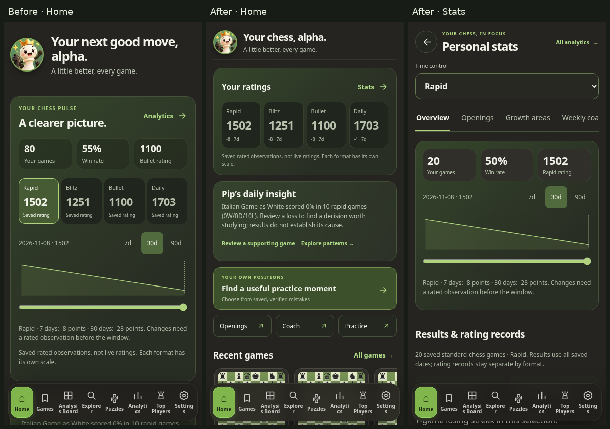

# Compact Home and focused personal stats

## Problem and reference

Home had accumulated full rating charts, engine evidence, weekly coaching, Practice Studio, opening reports and milestones in one feed. With the same 80 saved standard-chess games, its height at 393px was 6,677px (welcome dismissed). The user supplied 13 screenshots showing a rating/format selector and a horizontally scrollable topic bar. Some pictured advanced reports were behind an upgrade screen, so the references establish layout and interaction, not the availability of their underlying calculations.

This stage uses that navigation pattern with Chess Analyser's Pip identity, green palette and existing reports. No third-party artwork, profile details, subscription UI or calculated scores were copied.

## Acceptance criteria

- Home presents four independently labelled saved ratings, one Pip observation, one primary continuation action, three study shortcuts and five genuine saved-board previews. At the supported widths it remains below 1,150px in the seeded acceptance journey, rather than appending every report.
- Tapping a rating opens that format's personal Stats overview. The format selector drives the existing rating chart, selected-format result totals, colour performance and opening reports. All-formats mode never produces a combined rating chart.
- Overview, Openings, Growth areas, Weekly coach and Practice replace the topic body. Only one panel is visible. Topic arrows/Home/End work with a roving tab stop, and the strip scrolls horizontally on small screens. Controls have at least 44px height.
- Weekly coach and Practice retain their own existing, clearly labelled evidence/period controls; the overview format selector is shown only where it applies. The 7/30/90-day buttons explicitly control the rating chart. Results/openings use all saved dates; growth retains its 90-day evidence window.
- Existing controllers, evidence thresholds, cancellation, actual Stockfish validation, practice progress, replay links, username isolation and storage are preserved. There are no additional public-data requests or new engine work on initial Home load. The only new assets are the small local layout module and stylesheet.
- Native Back returns from Stats to compact Home in one step. Topic/format changes replace that detail history entry. Forward restores the topic and format. Review/Analysis Board source links return to their originating topic. The existing global navigation controller remains the only owner of screen visibility.
- Mobile navigation remains visible, positioned and hit-testable outside Review, including ten repeated topic → saved Review → Back → Home journeys, using on-screen and native Back.
- The service-worker shell includes the new module and stylesheet, without changing IndexedDB or user preference formats.

## Implementation

`home-sections.js` reparents existing report sections inside the same Home root; it does not create another analytics model or second Practice Studio. `ux-shell.js` records a Home detail in the existing browser history. The existing full Analytics and Friends & Players destinations remain reachable from the detail header and bottom navigation.

Full rating records are expandable inside Overview. The first-visit Pip welcome remains explicit and silent until the player chooses sound. Entering a detail destination also invokes the existing feedback cleanup, stopping welcome audio and pending motion; a test reproduced the missing cleanup before the fix and passes afterward. Existing feedback handles the new buttons without new audio contexts or assets.

## Validation

All **212 unit/integration tests**, `npm run check:ui`, and the complete **390-test Playwright matrix** pass. The final browser reports have zero failures, retries, flaky results or skipped tests. The results were checked against the full test-list manifest, ensuring no project/test was omitted.

| Browser project | Passed |
| --- | ---: |
| Android touch emulation, 360 × 800 | 103 |
| Android touch emulation, 393 × 800 | 103 |
| Android touch emulation, 430 × 800 | 103 |
| Desktop Chromium, 1280 × 900 | 81 |

The corrected puzzle timing test also passed 12 separate repeated runs. [Sanitized result summary](screenshots/compact-home/test-results.json). CI has not run for this branch yet: GitHub's PR API returns `Forbidden`. The tested branch can be pushed through native Git; it must remain unmerged until a PR is opened and hosted checks pass.

The same fixture measured these Home section heights (welcome dismissed):

| Width | Before | After | Reduction |
| --- | ---: | ---: | ---: |
| 360 | 7,018px | 1,014px | 86% |
| 393 | 6,677px | 1,014px | 85% |
| 430 | 6,635px | 999px | 85% |
| 1280 | 5,251px | 825px | 84% |

Inspected viewport captures, using the same saved-game fixture before/after:

| Viewport | Before Home | After Home | Stats overview |
| --- | --- | --- | --- |
| 360 × 800 | [Before](screenshots/compact-home/before-360.png) | [After](screenshots/compact-home/after-360.png) | [Stats](screenshots/compact-home/stats-360.png) |
| 393 × 800 | [Before](screenshots/compact-home/before-393.png) | [After](screenshots/compact-home/after-393.png) | [Stats](screenshots/compact-home/stats-393.png) |
| 430 × 800 | [Before](screenshots/compact-home/before-430.png) | [After](screenshots/compact-home/after-430.png) | [Stats](screenshots/compact-home/stats-430.png) |
| 1280 × 900 | [Before](screenshots/compact-home/before-1280.png) | [After](screenshots/compact-home/after-1280.png) | [Stats](screenshots/compact-home/stats-1280.png) |

The topic strip deliberately scrolls horizontally; the page does not. The fixed mobile navigation overlaps the viewport's lower content during scrolling, with existing bottom clearance preserving access to the final card. The new reports retain the established global navigation visibility rules. Eight existing bottom destinations still use compact labels at these widths; simplifying that navigation is a separate design change.

The complete suite exposed an existing puzzle-reply timing race in the test: under load, the 280ms automatic reply could finish before the test clicked Home. The cancellation test now pauses the browser clock before the real move/navigation journey, asserts the reply is pending, advances time while Home is open, and checks silent resumption on return. This changes the test timing control only; puzzle reply logic is unchanged.

After ten source-review exits, inspected screenshots are retained for [360px](screenshots/compact-home/after-review-360.png), [393px](screenshots/compact-home/after-review-393.png), [430px](screenshots/compact-home/after-review-430.png) and [desktop](screenshots/compact-home/after-review-1280.png). Opening topic screenshots are retained at [360px](screenshots/compact-home/openings-360.png), [393px](screenshots/compact-home/openings-393.png), [430px](screenshots/compact-home/openings-430.png) and [desktop](screenshots/compact-home/openings-1280.png).

Back/Forward and reload have explicit acceptance tests. Reload returns to Home and discards the stale detail-history marker, so a subsequent rating tap still creates a genuine Home return entry. Automated tests use deterministic public/saved-game fixtures; they do not establish live API availability or real-device vibration support. The browser matrix uses Chromium touch emulation at 360, 393 and 430px and desktop 1280px.
