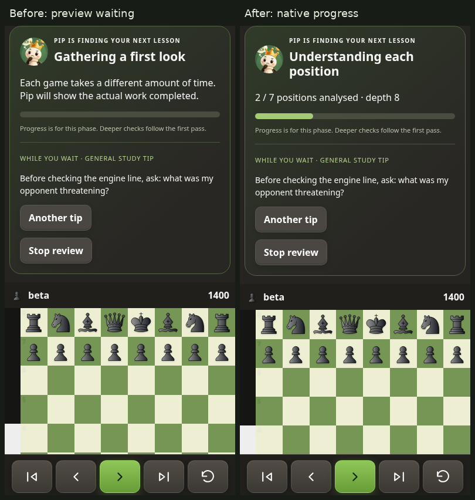
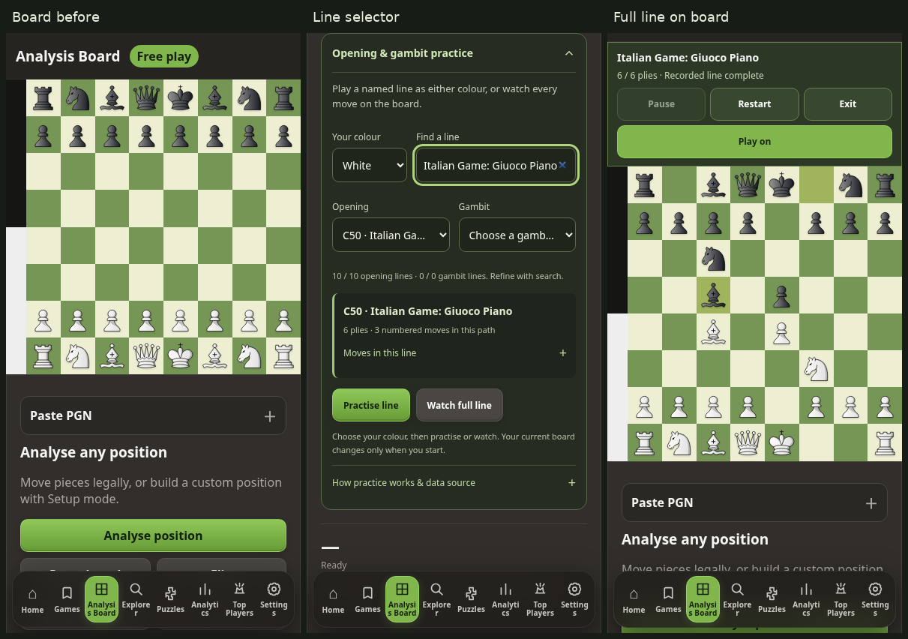

# Review startup and complete opening-line lessons

## Review startup

The supplied Android screenshot shows the indeterminate “Getting Stockfish ready” panel. Its “Another tip” handler only changes text; no tip handler starts or releases the engine. The exact physical-device input dependency could not be established from a screenshot alone.

Source inspection found that a fresh review ran a separate public cloud preview (including live fallback and tactical requests) before it launched the existing authoritative local verifier. Existing wait-panel fixtures pre-populated the cloud preview cache and therefore skipped this dependency. A new fresh-review browser test holds public preview requests open, presses Start Review once and waits for two native Stockfish positions. It fails before the change with the generic waiting caption, and passes after it without a tip click or any preview API request.

Start Review now reserves its run before the storage await, checks its saved review, then invokes the existing local verifier directly. The superseded network preview pipeline is removed from this startup path. Saved complete reviews still restore immediately; depth selection, exact coverage checks, native classifications, cache writes, cancellation and verified autoplay remain in the existing verifier. No guessed scores or incomplete review are saved as complete. Cancelling a fresh run leaves the game explorable without fabricated preview tags.

Acceptance:

- Fresh local analysis starts with one Start Review action and no subsequent tip interaction, even when preview services never respond.
- A native cold review completes, clears the waiting panel and starts the mobile review automatically.
- Slow worker initialization progresses automatically when ready. Changing tips does not duplicate an engine job.
- Worker failure produces an error/retry state; retry completes without touching tips.
- Cancellation, retry, source identity checks, depth, complete cached restoration and repeated mobile/browser Back journeys remain reliable.

## Opening and gambit lessons

The existing Analysis Board has a collapsible selector for the player's colour, opening and gambit, plus search across **3,865** named ECO paths. **1,315** paths have “gambit” in their supplied names, including accepted/declined variants. Source: the public-domain/CC0 lichess-org/chess-openings snapshot at `3ba6b20d31b2e6125cb0e6a2e792f400717d9d39`. [Source and licence](../data/openings/README.md).

Each picker shows at most 100 matching paths to bound mobile DOM work. Search covers the entire snapshot. The selected name, ECO, exact ply count and expandable PGN identify the path before the board changes.

- **Watch full line** plays every recorded ply for both sides on the actual board, then stops at the exact endpoint. Playback is silent, with Pause, Resume, Restart, Exit and optional Play on controls next to the board. Terminal paths such as Fool’s Mate disable continuation instead of waiting for an impossible engine reply.
- **Practise line** lets the player choose White or Black. The opponent plays the opposite side's recorded moves. Legal deviations are explicitly rejected with the expected book move; Hint identifies the selected path, not an engine recommendation. Exit restores free analysis. Once the recorded path is complete, local Stockfish chooses its own continuation. Those moves are explicitly labelled free play.
- All moves use the existing chess.js board, legality, orientation, feedback and history. This adds no second board or engine. Automatic moves are quiet; normal user moves use the existing preference-aware feedback.
- History, reset, setup, imported study positions, navigation and visibility cleanup cancel pending playback or engine work. Stale completions cannot move a different position. The desktop active board adapts to keep the board and lesson controls in the viewport.
- Catalogue loading is explicit, local and retryable. Previously loaded lines work offline. No initial engine work, history download, private API, session data or new dependency is introduced. The service-worker shell includes the module/styles and caches the catalogue after explicit use; IndexedDB and saved preferences are unchanged.

“Full line” means the complete selected recorded path, not every possible branch or a unique end to an opening. Short named definitions may have only one or a few moves; detailed variants offer longer paths. Stockfish play after the path is no longer constrained to the book. Practice is labelled pre-game study. Book playback is not counted as verified tactical-puzzle improvement.

## Validation

Latest local validation passes **221 unit/integration tests**, `npm run check:ui`, and **462 Playwright checks** on Node 22/Chromium 141, with no missing tests, failures, skips, retries or flaky results. The original 216-unit/438-browser baseline and subsequent CI investigations are historical evidence; hosted validation and remaining uncertainty are recorded below. See [latest press and lifecycle results](screenshots/opening-lessons/ci-press-tests.json).

| Project | Passed |
| --- | ---: |
| Mobile Chromium, 360 × 800 | 121 |
| Mobile Chromium, 393 × 800 | 121 |
| Mobile Chromium, 430 × 800 | 121 |
| Desktop Chromium, 1280 × 900 | 99 |

[Initial local test summary](screenshots/opening-lessons/test-results.json). PR [#72](https://github.com/rk93/chess-analyser/pull/72) is open. Its first hosted Mobile visual QA run failed the cancellation/completion/reopening journey (437 passed, one failed). The correction and subsequent validation are recorded below; initial local results do not establish hosted CI success.

 Unit coverage plays every shipped catalogue PGN legally and checks endpoints, colour ownership, rejection of deviations, watch mode and search. Browser coverage uses real board moves and native Stockfish for continuation, plus cancellation, offline/error/retry, reduced motion, actual navigation hit tests and 360/393/430px and desktop captures. Physical Android audio/vibration and the precise reported gesture dependency are outside this emulated browser check.

## Rendered evidence

The baseline is main `53121cd`; the current branch is tested with the same legal PGN and public preview services held open. The after-startup captures hold the *third* native search solely to retain a stable screenshot after two actually analysed positions. No UI class or engine-progress value is manually set. Tip text remains on its first tip in both captures.

| Viewport | Board before | Selector | Full-line endpoint | Review before | Review after |
| --- | --- | --- | --- | --- | --- |
| 360px | [Before](screenshots/opening-lessons/board-before-360.png) | [Selector](screenshots/opening-lessons/selector-360.png) | [Line](screenshots/opening-lessons/book-360.png) | [Waiting](screenshots/opening-lessons/review-before-360.png) | [Progress](screenshots/opening-lessons/review-after-360.png) |
| 393px | [Before](screenshots/opening-lessons/board-before-393.png) | [Selector](screenshots/opening-lessons/selector-393.png) | [Line](screenshots/opening-lessons/book-393.png) | [Waiting](screenshots/opening-lessons/review-before-393.png) | [Progress](screenshots/opening-lessons/review-after-393.png) |
| 430px | [Before](screenshots/opening-lessons/board-before-430.png) | [Selector](screenshots/opening-lessons/selector-430.png) | [Line](screenshots/opening-lessons/book-430.png) | [Waiting](screenshots/opening-lessons/review-before-430.png) | [Progress](screenshots/opening-lessons/review-after-430.png) |
| 1280px | [Before](screenshots/opening-lessons/board-before-1280.png) | [Selector](screenshots/opening-lessons/selector-1280.png) | [Line](screenshots/opening-lessons/book-1280.png) | [Waiting](screenshots/opening-lessons/review-before-1280.png) | [Progress](screenshots/opening-lessons/review-after-1280.png) |

Mobile and desktop captures were inspected for horizontal overflow, complete board visibility in lesson mode, control placement and persistent navigation. The selector deliberately uses ellipsis for long names; the preview shows the selected complete name. Loading the catalogue does not alter the current board. Longer PGNs are expandable and scroll within their disclosure.

## PR #72 CI follow-up

The reported hosted run [42911754375](https://github.com/rk93/chess-analyser/actions/runs/42911754375) failed the same journey at two different assertions: first-search startup within five seconds, then verified completion within sixty seconds on retry. Public workflow pages confirm the failed run. The environment denies the GitHub API domain, and detailed logs/artifacts require authentication; the exact worker state on that hosted retry is therefore unconfirmed. The unchanged journey passed twenty repeated local runs before this correction.

A controlled six-second worker-script load reproduces the five-second assertion failure while the application's ten-second startup deadline has not expired. The startup assertion now allows that existing deadline plus polling overhead (twelve seconds). The sixty-second verified-completion assertion is unchanged. A separate unit reproduction confirms that an error **after** `readyok` terminates the worker but leaves the old readiness promise resolved. The next `ready()` previously returned that stale success instead of creating a worker. This is a confirmed recovery defect, not proof that the hosted retry encountered a worker crash.

Worker failures now invalidate readiness and reject an active search promptly. A stopped search normally drains `bestmove` before the queue advances; if it fails to drain within two seconds, its worker is terminated and the next queued request creates a fresh one. A thirty-second search timeout also retires its worker. Search listeners capture the worker identity, and late results from a retired worker cannot complete another position. Review depths, move legality, stored analysis schemas and successful review calculations are unchanged. Service-worker shell version is v98 so returning clients receive the corrected engine controller.

Permanent tests exercise runtime `error`/`messageerror`, normal stop draining, a missing stop response, timeout recovery and stale results. The browser journey runs four ways at every viewport: normal, a six-second UCI startup delay, an unresponsive stop, and a crash on stop. The fault cases still use native Stockfish for the reopened review and require complete, exact, correctly versioned cached analysis, then actual app/browser Back and Forward transitions with usable navigation. They assert that a failed worker is replaced once. Every attempt attaches bounded command timing, worker/error counts, progress phases, status text and cache evidence for future CI diagnosis.

Final follow-up: **221 unit/integration tests** pass on Node 24.19.0 and Node 20; the UI bundle check passes. All **450 browser regression checks** pass in 775 seconds: 118 each at 360px, 393px and 430px, and 96 on desktop. The report matches the full test manifest with no missing tests, skips, retries, flaky results or failures. The separate 16-case targeted lifecycle run also passes. [Sanitized follow-up results](screenshots/opening-lessons/ci-follow-up-tests.json). Hosted workflows remain a separate merge gate.

The before image is the deliberately delayed startup that fails the old five-second assertion; it is not a capture from GitHub's runner. The after images show the real Games screen after cancellation and after verified completion/browser Back, including recovery from an injected worker crash. All four viewport captures were inspected, with navigation visible and the existing hit-test assertions passing.

| Viewport | After cancellation | After verified completion and browser Back |
| --- | --- | --- |
| 360px | [Capture](screenshots/opening-lessons/ci-after-cancelled-360.png) | [Capture](screenshots/opening-lessons/ci-after-completed-360.png) |
| 393px | [Capture](screenshots/opening-lessons/ci-after-cancelled-393.png) | [Capture](screenshots/opening-lessons/ci-after-completed-393.png) |
| 430px | [Capture](screenshots/opening-lessons/ci-after-cancelled-430.png) | [Capture](screenshots/opening-lessons/ci-after-completed-430.png) |
| 1280px | [Capture](screenshots/opening-lessons/ci-after-cancelled-1280.png) | [Capture](screenshots/opening-lessons/ci-after-completed-1280.png) |

[Controlled startup failure before the assertion correction, 393px](screenshots/opening-lessons/ci-slow-start-before-393.png).

The first follow-up hosted attempt on `f9e819e` passed [Tests](https://github.com/rk93/chess-analyser/actions/runs/42919677416) but failed [Mobile visual QA](https://github.com/rk93/chess-analyser/actions/runs/42919677465). Its public annotation only reports exit code 1, and the authenticated failure logs remain inaccessible in this environment. This does **not** establish that the original hosted failure is resolved. Playwright's standard GitHub reporter is enabled alongside the existing list/HTML reports when `GITHUB_ACTIONS` is set, so subsequent failed assertions are exposed as workflow annotations. The suite, assertions, timeouts and retries are unchanged by this diagnostic configuration. The PR must remain gated on both hosted workflows.

## Shared startup contract and hosted diagnostics

The diagnostic hosted run on `313af4f` returned successful workflow statuses but reported **449 passed and one flaky test**: desktop unresponsive-stop recovery timed out waiting for native verification on its first attempt, then passed on retry. It was deliberately left unmerged. The annotation identifies the assertion but the matcher omitted the extra phase/worker fields; the authenticated detailed artifact remains unavailable. The exact trigger of that hosted timeout is still unconfirmed. Twenty-four further desktop repetitions on Node 22/Chromium 141 passed without retries. Verification failures now print the phase, status, visibility, document time origin, hold threshold, button state, bounded UCI commands and lifecycle events directly in the assertion, in addition to attaching the JSON. A green workflow with a flaky test is insufficient for this delivery.

A further deterministic startup reproduction holds the initial UCI request for nine seconds: the fresh-review test's old eight-second combined startup/progress assertion fails, although the application's ten-second startup deadline remains valid. The engine now exports its unchanged ten-second deadline, and a shared test helper uses that deadline plus two seconds for polling. The navigation, opening-continuation and weekly-practice startup checks use the helper while retaining their engine-call count assertions. The fresh-review test separates startup from the **unchanged eight-second two-position analysis assertion**. It runs both normal and nine-second starts at every viewport, still holding public preview requests open and requiring zero preview requests and actual native progress without a tip interaction. The sixty-second complete-verification deadline is unchanged.

Final local cross-browser validation: **221 unit/integration tests on Node 20**, the UI bundle check, and **454 browser checks on Node 22/Chromium 141** pass. There are 119 checks at each mobile width and 97 on desktop; the report matches the full manifest with no skipped, retried, flaky or failed tests. The full run took 634 seconds. Additional runs passed 96 original lifecycle/startup repetitions on Node 22/Chromium 154, eight normal/nine-second checks on Chromium 141, and 24 desktop unresponsive-stop repetitions. The last diagnostic-only refinement expands failure messages without changing their predicates or deadlines. [Sanitized cross-browser results](screenshots/opening-lessons/ci-cross-browser-tests.json).

The local Chromium 141 binary is the separately installed Sparticuz 141.0.7390.0 package; hosted Playwright uses 141.0.7390.37 (revision 1194). This matches the major version, not the exact CI build. No browser package or application dependency was added to the repository. The previous full Chromium 154 run and its 450-case results remain recorded above. Hosted CI on the published final head remains a separate gate and must finish cleanly before merge.

The nine-second before image shows the old assertion expiring while startup remains valid. After images show two **actually analysed** positions on the same legal PGN and initial tip; the third native search is held only to keep captures stable. All four were inspected. No progress, routing class or UI visibility is manually set.

| Controlled nine-second startup | Capture |
| --- | --- |
| Old combined eight-second assertion, 393px | [Before](screenshots/opening-lessons/ci-nine-second-before-393.png) |
| Separate startup/progress assertions, 360px | [After](screenshots/opening-lessons/ci-nine-second-after-360.png) |
| Separate startup/progress assertions, 393px | [After](screenshots/opening-lessons/ci-nine-second-after-393.png) |
| Separate startup/progress assertions, 430px | [After](screenshots/opening-lessons/ci-nine-second-after-430.png) |
| Separate startup/progress assertions, desktop | [After](screenshots/opening-lessons/ci-nine-second-after-1280.png) |

## Confirmed review lifecycle race

A separate deterministic reproduction found a product defect beyond the test deadlines. The core review controller reset its token and UI in an asynchronous `MutationObserver` on the game title. Opening a real saved-game card and immediately invoking the existing Review button from the app's `savedGameOpened` event started a run, then that queued title reset invalidated its token before the storage await resumed. No worker was created. The UI remained “Getting Stockfish ready,” with its Review button disabled and reset to “Review game.” The captured event sequence records `gameReviewRunning: true`, then `false` roughly nine milliseconds later, with zero workers, UCI requests or native progress. [Baseline state](screenshots/opening-lessons/ci-immediate-start-before-state.json).

The core reset now runs synchronously from the existing game-open event, after the app has installed the title and moves. It cancels the previous game's audit, resets the new game's UI and explicitly enables its Review button. The asynchronous title observer no longer owns job state. Initial setup, cache-restore generation guards and the existing verifier remain in place. No additional engine or preview pipeline is introduced. The service-worker shell is v99; analysis schemas and preferences are unchanged.

A permanent integration test uses the actual game-card click and app lifecycle event, then the existing button handler. It changes no routing class or progress value. The baseline fails with the stuck state above. After the fix, all four viewport checks reach two actual native positions without a tip tap; the complete regression also checks that no depth prompt interrupts this start and the button is disabled only while actual work runs. The third native search is held for a stable capture. All before/after captures were inspected. This establishes the immediate-start race; the precise trigger of the earlier hosted unresponsive-stop timeout remains unconfirmed unless its diagnostic state matches it.

| Immediate game-open start | Capture |
| --- | --- |
| Before lifecycle fix, desktop | [Stuck](screenshots/opening-lessons/ci-immediate-start-before-1280.png) |
| After, 360px | [Native progress](screenshots/opening-lessons/ci-immediate-start-after-360.png) |
| After, 393px | [Native progress](screenshots/opening-lessons/ci-immediate-start-after-393.png) |
| After, 430px | [Native progress](screenshots/opening-lessons/ci-immediate-start-after-430.png) |
| After, desktop | [Native progress](screenshots/opening-lessons/ci-immediate-start-after-1280.png) |

After the lifecycle fix, **221 unit/integration tests**, the UI bundle check and **458 browser checks** pass on Node 22/Chromium 141 (120 per mobile width, 98 desktop) in 636 seconds. The final report matches the complete manifest with no failures, skipped tests, retries or flaky results. Twenty-four additional desktop unresponsive-stop journeys also pass after this fix. The current navigation captures after verified completion were inspected at all four widths. [Final local lifecycle results](screenshots/opening-lessons/ci-lifecycle-tests.json).

The preceding hosted attempt on `10758c6` returned workflow success with **452 passed and two flaky tests** and was also deliberately not merged. The public state for its desktop nine-second startup case contains zero workers, requests, native progress and errors, and no `gameReviewRunning` event: no engine job began. Another desktop waiting-flow case retained an empty progress caption. These observations rule out a slow active engine for those attempts, but do not establish the exact click-delivery sequence. The independently reproduced title-reset race above is fixed; the published final head still requires a clean hosted run before merge.

## Confirmed lost pointer press

The next hosted attempt on `a3edf5f` completed with 457 passed and one flaky desktop reopening case, and was deliberately not merged. Its diagnostic state showed that the first search stopped correctly (`go: 1`, `stop: 1`, one real `bestmove`), but no second `gameReviewRunning` event or engine request followed reopening. The worker was idle, the page was visible and the button was enabled. This narrowed the remaining failure to the start action, rather than a slow active search.

A direct pointer reproduction found another asynchronous writer: `auto-analysis.js` scheduled an instruction rewrite 180 ms after a library game-card click. Replacing the short engine instruction with a longer sentence increased the panel height and moved the Review button **19.59375 px** during a press. A valid press five pixels below the original button's top released over a `DIV`, outside the moved button; no click reached Review and no engine job began. The permanent desktop regression fails on that hit test before the fix. [Measured before/after state](screenshots/opening-lessons/ci-press-state.json).

The redundant delayed UI rewrite and its unused instruction function are removed. The existing `savedGameOpened` lifecycle now invokes the existing position-announcement path; Game Review owns the UI reset. Move navigation and position notifications remain, using the actual current ply. No CSS override, button-wait workaround, engine calculation change or extra runtime delay is introduced. This also prevents the old callback overwriting the engine instructions after a quick completed review. The service-worker shell is v100; IndexedDB and preferences remain unchanged.

The regression uses the actual game-card pointer click and the actual Start control. It holds desktop mouse input, or real Chromium touch input on each mobile depth dialog, while Playwright's clock advances the opening callbacks by 240 ms. Reduced motion isolates content reflow from intentional press animation. It checks `elementFromPoint` at the original valid press point, releases there, resumes the clock and requires two actual native Stockfish positions. It changes no routing class, button position or progress value. All four controls remain under the release point after the fix, and 24 further repetitions pass without retries.

Final local validation after the stable-control fix: **221 unit/integration tests**, the UI bundle check and **462 browser checks** (121 at each mobile width, 99 desktop) pass. The full report matches the manifest with no missing tests, failures, skips, retries or flaky results, in 621 seconds. The 24 additional mouse/touch press repetitions also pass. All before/after press captures were inspected. The local browser build differs from CI as documented above; the published final head still requires a clean hosted report before merge. [Final local results](screenshots/opening-lessons/ci-press-tests.json).

| Start-control press | Capture |
| --- | --- |
| Lost release before the fix, desktop | [Before](screenshots/opening-lessons/ci-press-before-1280.png) |
| Stable touch release and native progress, 360px | [After](screenshots/opening-lessons/ci-press-after-360.png) |
| Stable touch release and native progress, 393px | [After](screenshots/opening-lessons/ci-press-after-393.png) |
| Stable touch release and native progress, 430px | [After](screenshots/opening-lessons/ci-press-after-430.png) |
| Stable mouse release and native progress, desktop | [After](screenshots/opening-lessons/ci-press-after-1280.png) |
